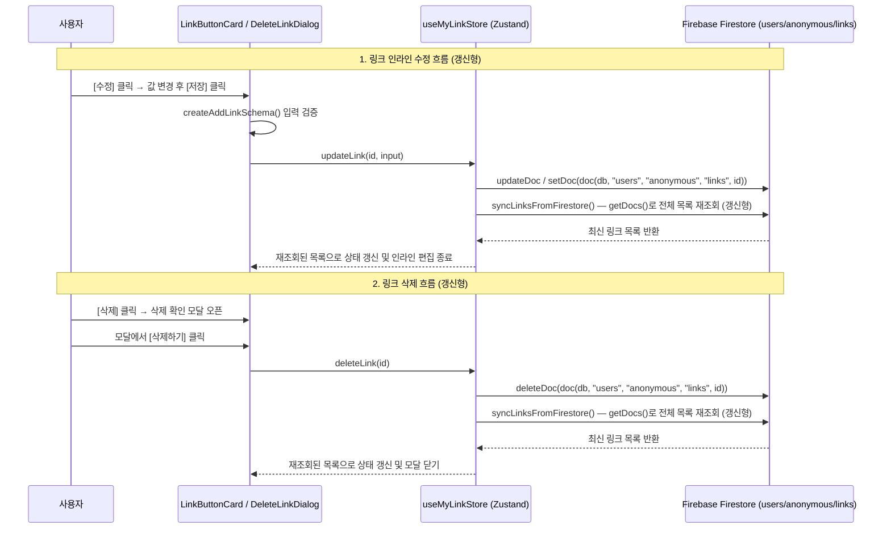

# 링크 수정 및 삭제 기능 명세서 (Link Edit & Delete Specification)

> **문서 버전**: v1.0  
> **작성일**: 2026-11-15  
> **연동 경로**: Firebase Firestore `users/anonymous/links` (`FIRESTORE_LINKS_COLLECTION_PATH`)  
> **관련 컴포넌트**: [`LinkButtonCard`](../src/components/mylink/link-button-card.tsx), [`DeleteLinkDialog`](../src/components/mylink/delete-link-dialog.tsx), [`AddLinkDialog`](../src/components/mylink/add-link-dialog.tsx), [`useMyLinkStore`](../src/store/useMyLinkStore.ts)

---

## 1. 개요 (Overview)

각 링크 카드([`LinkButtonCard`](../src/components/mylink/link-button-card.tsx))에서 링크 정보를 즉시 편집할 수 있는 **인라인 수정(Inline Edit) UI**와 실수로 인한 삭제를 방지하는 **삭제 확인 모달([`DeleteLinkDialog`](../src/components/mylink/delete-link-dialog.tsx))** 기능을 정의합니다. 모든 수정·삭제 작업은 링크 추가 시 사용한 것과 동일한 Firebase Firestore 컬렉션 경로(`users/anonymous/links`)와 연동됩니다.

---

## 2. 링크 카드 상시 노출 액션 버튼

- **위치**: 각 [`LinkButtonCard`](../src/components/mylink/link-button-card.tsx) 우측 영역
- **표시 방식**: 마우스 호버(Hover) 여부와 무관하게 **항상 표시(Always Visible)**
- **구성 버튼**:
  1. **[수정] 버튼**: 클릭 시 해당 링크 카드가 즉시 **인라인 편집 모드(`InlineEditLinkForm`)**로 전환됩니다.
  2. **[삭제] 버튼**: 클릭 시 **삭제 확인 모달(`DeleteLinkDialog`)**을 호출합니다.
- **이벤트 분리**: 수정/삭제 버튼 클릭 시 외부 링크(`href`) 이동이 발생하지 않도록 영역 분리 및 `preventDefault()` / `stopPropagation()` 처리가 적용되어 있습니다.

---

## 3. 링크 인라인 수정 (Inline Edit UI & 입력 검증)

### 3.1 인라인 편집 UI 구성
`[수정]` 버튼을 클릭하면 모달을 띄우지 않고 카드 자리에서 바로 인라인 폼(`data-slot="link-button-card-editing"`)으로 전환됩니다.

- **입력 필드**:
  1. **카테고리 섹션 선택**: 소속 섹션 변경 가능 (변경 시 제목/URL 중복 검증 즉시 재실행)
  2. **아이콘 이모지**: 12종 프리셋 버튼 클릭 또는 직접 입력 (최대 4자)
  3. **링크 제목**: 실시간 글자 수 카운터(`{현재 글자 수}/40`) 표시
  4. **한 줄 설명 (선택)**: 실시간 글자 수 카운터(`{현재 글자 수}/80`) 표시
  5. **이동할 URL**: 유효한 URL 입력 시 정규화된 연결 주소(`연결 주소: https://...`) 실시간 미리보기 제공
- **하단 액션 버튼**:
  - **[취소]**: 변경 사항을 취소하고 기본 카드 뷰로 복귀
  - **[저장]**: 입력 검증 통과 시 Firebase Firestore 문서를 업데이트하고 목록을 재동기화

### 3.2 입력 검증 규칙 (링크 추가와 동일)
[`add-link-dialog.tsx`](../src/components/mylink/add-link-dialog.tsx)의 `createAddLinkSchema(sections, link.id)` 및 `isValidLinkUrl()`을 그대로 재사용하여 **링크 추가 시와 100% 동일한 입력 검증**을 수행합니다.

| 필드명 | 필수 여부 | 검증 규칙 | 오류 메시지 |
| :--- | :---: | :--- | :--- |
| **카테고리 섹션 (`sectionId`)** | 필수 | 최소 1자 이상 선택 | `"카테고리 섹션을 선택해주세요."` |
| **아이콘 이모지 (`emoji`)** | 필수 | 공백 제외 1~4자 이내 | `"아이콘 이모지를 선택하거나 입력해주세요."`<br>`"이모지는 최대 4자까지 입력할 수 있어요."` |
| **링크 제목 (`title`)** | 필수 | 공백 제외 **2자 이상 ~ 40자 이하**<br>동일 섹션 내 타 링크와 제목 중복 불가 (본인 링크 제외) | `"링크 제목은 최소 2자 이상 입력해주세요."`<br>`"링크 제목은 40자 이내로 입력해주세요."`<br>`"선택한 섹션에 동일한 제목의 링크가 이미 등록되어 있어요."` |
| **한 줄 설명 (`description`)** | 선택 | 공백 제외 **80자 이하** | `"한 줄 설명은 80자 이내로 입력해주세요."` |
| **이동할 URL (`href`)** | 필수 | - 공백 포함 불가<br>- `javascript:`, `data:` 프로토콜 차단<br>- `http://`, `https://`, `mailto:`, `tel:` 지원 및 프로토콜 미입력 시 `https://` 자동 보정<br>- 유효 도메인(`.` 포함 2자 이상 TLD 또는 `localhost`) 검증<br>- 동일 섹션 내 타 링크와 정규화 URL 중복 불가 (본인 링크 제외) | `"이동할 URL 주소를 입력해주세요."`<br>`"URL 주소에는 공백을 포함할 수 없어요."`<br>`"올바른 도메인 주소를 입력해주세요. (예: https://example.com)"`<br>`"선택한 섹션에 동일한 URL 주소가 이미 등록되어 있어요."` |

---

## 4. 삭제 확인 모달 (`DeleteLinkDialog`)

링크 카드에서 **[삭제]** 버튼을 클릭하면 [`DeleteLinkDialog`](../src/components/mylink/delete-link-dialog.tsx) 모달이 표시됩니다.

### 4.1 모달 UI 구성 요소
- **제목**: `"정말 삭제하시겠습니까?"`
- **삭제 대상 링크 이름 표시**: 삭제할 링크의 아이콘 이모지(`link.emoji`), **링크 제목(`link.title`)**, 이동 URL(`link.href`)을 박스 형태로 명확히 표시
- **경고 문구 (빨간색)**: `"이 작업은 되돌릴 수 없습니다"` (`text-destructive` 시맨틱 레드 컬러 + 경고 아이콘 적용)
- **하단 버튼 및 삭제 로딩 표시**:
  - **[취소]**: 모달을 닫고 삭제를 취소 (`Button` `variant="secondary"`, 삭제 중 비활성화)
  - **[삭제하기]**: `shadcn/ui` [`Button`](../src/components/ui/button.tsx)의 **`variant="destructive"` 디자인**을 적용하며, 클릭 시 별도의 로딩 텍스트 문구 없이 버튼 내부 아이콘만 회전 스피너(`Loader2`)로 전환됩니다.

---

## 5. Firebase Firestore 연동 구조 (실시간 구독이 아닌 `getDocs` 갱신형)

링크 추가(`addLink`)와 동일하게 실시간 구독(`onSnapshot`)이나 로컬 낙관적 업데이트를 사용하지 않고, **Firestore에 수정/삭제 요청이 완료된 직후 `syncLinksFromFirestore()`(`getDocs`)를 다시 호출하여 목록을 재조회·갱신하는 방식(갱신형)**으로 동작합니다. 경로 또한 [`useMyLinkStore.ts`](../src/store/useMyLinkStore.ts)의 `FIRESTORE_LINKS_COLLECTION_PATH` 상수를 그대로 사용합니다.

```typescript
export const FIRESTORE_LINKS_COLLECTION_PATH = [
  "users",
  "anonymous",
  "links",
] as const;
```



### 5.1 스토어 액션 요약 ([`src/store/useMyLinkStore.ts`](../src/store/useMyLinkStore.ts))
- **갱신형 동작 원칙**:
  - `onSnapshot` 실시간 리스너를 사용하지 않습니다.
  - 링크 추가(`addLink`)와 동일하게 Firestore 문서 쓰기/삭제 완료 후 `await get().syncLinksFromFirestore()`를 호출해 `getDocs(query(linksColRef, orderBy("createdAt", "desc")))`로 최신 목록을 다시 받아와 화면을 갱신합니다.
- **`updateLink(id, input)`**:
  - `doc(db, "users", "anonymous", "links", id)` 참조를 생성하여 `updateDoc`으로 필드를 갱신합니다. (초기 시드 데이터 등 Firestore 문서가 아직 없는 항목은 동일 경로에 `setDoc(..., { merge: true })`로 저장합니다.)
  - Firestore 수정 완료 후 `syncLinksFromFirestore()`를 호출하여 최신 목록을 다시 조회(갱신)합니다.
- **`deleteLink(id)`**:
  - `doc(db, "users", "anonymous", "links", id)` 참조를 생성하여 `deleteDoc`으로 문서를 삭제합니다.
  - Firestore 삭제 완료 후 `syncLinksFromFirestore()`를 호출하여 최신 목록을 다시 조회(갱신)합니다.
