# 마이링크 (MyLink) — 제품 요구사항 정의서 (PRD)

> **문서 버전**: v1.5 (Tailwind CSS v4 단일 스타일링 통일 + `shadcn/ui` 기반 재사용 컴포넌트 아키텍처 반영)  
> **최종 수정일**: 2026-11-15  
> **기준 디자인 시스템**: `shadcn/ui` 컴포넌트 아키텍처 위에 [`design.md`](../design.md)의 **토스 디자인 시스템(TDS)** 토큰·스타일을 이식한 커스텀 디자인 시스템  
> **스타일링 원칙**: **CSS Modules(`.module.css`) 및 인라인 스타일(`style={{...}}`) 사용 금지** — `@theme inline`에 매핑된 **Tailwind CSS v4 유틸리티 클래스**(`cn`, `cva`)로 모든 화면·컴포넌트 스타일 통일  
> **기술 스택**: Next.js 16 (App Router) · React 19 · TypeScript 5 · Tailwind CSS 4 (CSS-first) · shadcn/ui · Lucide Icons · Zustand (`persist` LocalStorage)

---

## 1. 프로젝트 개요 (Overview)

### 1.1 배경 및 목적
**마이링크(MyLink)**는 개인 크리에이터, 개발자, 일반 사용자가 자신의 소셜 배지와 여러 채널·포트폴리오 링크를 한 페이지에 모아 소개할 수 있는 **링크트리(Linktree) 클론 바이오 프로필 서비스**입니다.

복잡한 회원가입이나 외부 데이터베이스 설정 없이도 브라우저 **LocalStorage(`zustand/middleware`의 `persist`)**와 초기 샘플 데이터를 기반으로 동작하며, 시연 흐름에 맞춰 **1단계(LocalStorage 기반 프로필 페이지)부터 순차적으로 기능을 확장**해 나가는 구조로 설계되었습니다.

### 1.2 핵심 가치 제안 (Value Proposition)
1. **Tailwind CSS v4 단일 스타일링 & `shadcn/ui` 기반 토스 디자인 시스템(TDS) 구현**: CSS Modules(`.module.css`)나 인라인 스타일 대신 **Tailwind CSS v4 유틸리티 클래스(`@theme inline`, `cva`, `cn`)로 모든 스타일을 통일**하며, 컴포넌트 구조는 **`shadcn/ui`**(`src/components/ui/*`)를 기반으로 [`design.md`](../design.md)의 **토스 디자인 시스템(TDS)** 시각 토큰으로 커스터마이징하여 구축합니다.
2. **재사용 가능한 `shadcn/ui` 기반 컴포넌트 아키텍처**: 페이지 파일([`src/app/page.tsx`](../src/app/page.tsx))에 마크업을 하드코딩하지 않고, `shadcn/ui` 프리미티브(`Button`, `Badge`, `Card`, `Avatar`)를 조합한 도메인 컴포넌트([`src/components/mylink/*`](../src/components/mylink/index.ts): `TopBar`, `ProfileHeroCard`, `SocialBadgeList`, `LinkSection`, `LinkButtonCard`, `ShareToast`)로 모듈화하여 공개 프로필 페이지와 향후 어드민 실시간 프리뷰 등에서 그대로 재사용합니다.
3. **직관적인 링크트리 정보 구조**: 중앙 정렬된 **프로필(80×80 아바타 + 이름/핸들 + 한 줄 소개 + 소셜 Pill 배지)**과 섹션별로 그룹화된 **링크 버튼 카드(Link Button Card)** 구조를 제공합니다.
4. **Zustand + LocalStorage 기반 상태 영속성**: 별도의 백엔드 없이도 브라우저 LocalStorage(`mylink_state_v1`)에 프로필·소셜 배지·링크 섹션 데이터를 자동 저장·복원하고 실시간 동기화를 지원합니다.

---

## 2. 타겟 페르소나 및 사용자 시나리오 (User Personas & Scenarios)

### 2.1 주요 페르소나 (Personas)
1. **프로필 소유자 (크리에이터 / 개발자 / 일반 사용자)**
   - **니즈**: 인스타그램, 유튜브, 기술 블로그, 오픈채팅방, 주요 프로젝트 링크를 깔끔한 모바일 바이오 링크 페이지 하나로 묶어 SNS 프로필에 걸어두고 싶다.
   - **페인 포인트**: 여러 플랫폼에 흩어진 채널을 일일이 소개하기 번거롭고, 기존 링크트리의 투박한 기본 테마 대신 토스 스타일의 세련된 UI를 사용하고 싶다.
2. **프로필 방문자 (구독자 / 채용 담당자 / 협업 제안자)**
   - **니즈**: 링크를 눌렀을 때 한눈에 누구인지 파악하고, 상단 소셜 배지(GitHub, Insta, Email)나 카테고리별 링크 버튼 카드를 클릭해 원하는 채널로 바로 이동하고 싶다.

---

### 2.2 핵심 사용자 시나리오 (User Scenarios)

#### 시나리오 A: 프로필 방문자의 링크 탐색 및 공유 (Visitor Flow)
- **상황**: 방문자가 인스타그램이나 카카오톡 프로필에 걸린 마이링크 URL(`/`)을 클릭해 접속한다.
- **단계별 행동 흐름**:
  1. **프로필 및 소셜 배지 확인**: 화면 상단 중앙의 `80×80` 라운드 아바타와 이름(`홍길동 (Gildong)`), 한 줄 소개(`"풀스택 개발자 & 크리에이터 🚀"`)를 확인하고, 바로 아래 `[ GitHub ]` `[ Insta ]` `[ Email ]` Pill 버튼을 눌러 소셜 채널로 빠르게 이동한다.
  2. **섹션별 링크 버튼 카드 탐색**:
     - `🚀 주요 프로젝트 & 포트폴리오` 섹션에서 `🎨 마이링크 (MyLink) 서비스` 카드나 `💻 개발 블로그 및 팁 (Velog)` 카드를 눌러 작업물을 확인한다.
     - `📢 소셜 채널` 섹션에서 `📺 개발자 홍길동 유튜브 채널` 또는 `💬 1:1 오픈채팅방` 카드를 클릭해 해당 채널로 이동한다.
  3. **프로필 공유**: 상단 우측의 공유 버튼(`[ ↗ ]`)을 클릭해 현재 프로필 링크를 클립보드에 복사하거나 공유한다.

#### 시나리오 B: LocalStorage 기반 상태 영속성 및 실시간 반영 시연 (Step 1 Demo Flow)
- **상황**: 시연자가 백엔드 서버 없이도 프론트엔드 전역 상태(`Zustand`)와 브라우저 `LocalStorage`만으로 링크트리 클론 페이지가 동작함을 시연한다.
- **단계별 행동 흐름**:
  1. **최초 접속 및 자동 시드(Seed) 생성**: 브라우저에서 프로필 페이지(`/`)에 처음 접속하면 기본 프로필과 링크 카드 데이터가 즉시 렌더링되고, `LocalStorage`의 `mylink_state_v1` 키에 JSON 데이터가 자동 저장된다.
  2. **데이터 구조 확인 및 직접 수정**: 개발자 도구(`F12` → `Application` → `Local Storage`)를 열어 `mylink_state_v1`에 저장된 `profile`, `socialBadges`, `linkSections` JSON 구조를 확인한다.
  3. **실시간 변경 검증**: LocalStorage JSON에서 이름(`name`), 한 줄 소개(`bio`), 또는 특정 링크 카드의 제목/노출 여부(`enabled`)를 수정한 뒤 새로고침(또는 다른 탭에서 변경)하면 화면에 즉시 반영된다.

#### 시나리오 C: 향후 확장 단계 — 어드민 편집 및 테마·통계 활용 (Step 2~4 Flow)
- **상황**: 사용자가 전용 관리 화면(`/admin`) 또는 편집 모드에서 노코드로 링크를 추가·정렬하고 통계를 확인한다.
- **단계별 행동 흐름**:
  1. **링크 CRUD 및 순서 변경**: 새 링크 카드를 추가하거나 드래그 앤 드롭으로 카드 순서를 바꾸면 실시간 프리뷰와 LocalStorage에 즉시 반영된다.
  2. **테마 커스터마이징 및 백업**: 라이트/다크 모드와 포인트 컬러를 변경하고, 데이터를 `.json` 파일로 내보내(Export) 백업한다.

---

## 3. 메인 화면 (`/`) 텍스트 와이어프레임 (Wireframe)

방문자가 보는 공개 프로필 화면([`src/app/page.tsx`](../src/app/page.tsx))의 모바일 퍼스트(`max-w-[560px]`) 레이아웃 구조입니다.

```text
+-------------------------------------------------------------------------+
| 📱 [MyLink App Shell]                                                   |
+-------------------------------------------------------------------------+
| [토스 프로필]                                                   [ ↗ ]   | <-- TopBar (공유 버튼)
+-------------------------------------------------------------------------+
|                                                                         |
|                           +---------------+                             |
|                           |   (Avatar)    |                             | <-- ProfileHeroCard (Avatar)
|                           |   📷 80x80    |                             |
|                           +---------------+                             |
|                                                                         |
|                           홍길동 (Gildong)                              | <-- Name & Handle
|                      "풀스택 개발자 & 크리에이터 🚀"                    | <-- Bio (한 줄 소개)
|                                                                         |
|                     [ GitHub ] [ Insta ] [ Email ]                      | <-- SocialBadgeList (Pill Buttons)
|                                                                         |
+-------------------------------------------------------------------------+
|                                                                         |
| 🚀 주요 프로젝트 & 포트폴리오                                           | <-- LinkSection Header
| +---------------------------------------------------------------------+ |
| | 🎨 마이링크 (MyLink) 서비스                                         | | <-- LinkButtonCard
| |    토스 디자인 시스템 기반의 바이오 프로필 서비스                 → | |
| +---------------------------------------------------------------------+ |
|                                                                         |
| +---------------------------------------------------------------------+ |
| | 💻 개발 블로그 및 팁 (Velog)                                        | | <-- LinkButtonCard
| |    웹 개발 관련 소소한 이야기와 지식을 공유합니다                 → | |
| +---------------------------------------------------------------------+ |
|                                                                         |
| 📢 소셜 채널                                                            | <-- LinkSection Header
| +---------------------------------------------------------------------+ |
| | 📺 개발자 홍길동 유튜브 채널                                        | | <-- LinkButtonCard
| |    신규 프레임워크 리뷰 및 코딩 시연 라이브                       → | |
| +---------------------------------------------------------------------+ |
|                                                                         |
| +---------------------------------------------------------------------+ |
| | 💬 1:1 오픈채팅방                                                   | | <-- LinkButtonCard
| |    협업 문의 및 질문을 언제든 환영합니다                          → | |
| +---------------------------------------------------------------------+ |
|                                                                         |
+-------------------------------------------------------------------------+
```

---

## 4. 단계별 시연 범위 (Staged Scope)

| 구분 | 포함 범위 | 상세 내용 |
| :--- | :--- | :--- |
| **현재 단계 (Step 1 · 구현 완료)** | **Mock API · JSON 더미 데이터 & LocalStorage 기반 프로필 페이지 (`/`) & `shadcn/ui` 재사용 컴포넌트화** | - **어드민 대시보드(`/admin`) 및 클릭/방문 통계 UI 제외**<br>- 백엔드 Mock API 응답 규격의 JSON 더미 데이터([`src/mocks/mylink-mock.json`](../src/mocks/mylink-mock.json)) 및 Mock API 엔드포인트(`GET /api/links`, [`src/app/api/links/route.ts`](../src/app/api/links/route.ts)) 구축<br>- **모듈 CSS(`.module.css`) 배제 및 Tailwind CSS v4 유틸리티 클래스 단일 통일** ([`src/app/globals.css`](../src/app/globals.css))<br>- `shadcn/ui` 프리미티브([`src/components/ui/*`](../src/components/ui/button.tsx)) 및 재사용 가능한 도메인 컴포넌트([`src/components/mylink/*`](../src/components/mylink/index.ts): `TopBar`, `ProfileHeroCard`, `SocialBadgeList`, `LinkSection`, `LinkButtonCard`, `ShareToast`) 분리 구현<br>- `Zustand` + `persist` 미들웨어로 Mock API 초기 시드 데이터를 LocalStorage(`mylink_state_v1`)에 저장 및 동기화 |
| **향후 확장 단계 (Step 2 ~ 4)** | **어드민 에디터(`/admin`), 테마 커스터마이징, 통계 대시보드** | - **`src/components/mylink/*` 재사용**: 어드민 실시간 프리뷰 화면에서도 Step 1에서 구축한 `ProfileHeroCard`, `LinkSection`, `LinkButtonCard` 컴포넌트를 그대로 재사용<br>- **Step 2**: 프로필·소셜 배지·링크 카드 CRUD(`Dialog`, `Input`, `Switch`) 및 드래그 앤 드롭 순서 변경 에디터<br>- **Step 3**: 라이트/다크 모드, 포인트 컬러 프리셋, 카드·버튼 스타일 커스터마이징<br>- **Step 4**: 링크 클릭 수·조회수 통계 대시보드 및 JSON 내보내기/불러오기/초기화 |

---

## 5. 프로필 페이지 (`/`) 상세 기능 요구사항 (Step 1 핵심 범위)

### 5.1 상단 앱 바 (`TopBar` · `ShareToast`)
| 기능 ID | 항목 | 담당 컴포넌트 | 상세 요구사항 |
| :--- | :--- | :--- | :--- |
| **TOP-01** | **앱 바 타이틀 & 공유 버튼** | [`TopBar`](../src/components/mylink/top-bar.tsx)<br>[`ShareToast`](../src/components/mylink/share-toast.tsx) | - 높이 `56px` 고정 헤더(`sticky top-0`), 좌측에 프로필 헤더 타이틀(예: `토스 프로필`) 표시<br>- 우측 `shadcn/ui` `Button`(`variant="outline"`, `size="icon"`) 클릭 시 현재 페이지 URL을 클립보드에 복사하고 하단 `ShareToast`(`"프로필 링크를 복사했어요"`, `shadow-tds-toast`) 표시 |

### 5.2 중앙 프로필 영역 (`ProfileHeroCard` · `SocialBadgeList`)
| 기능 ID | 항목 | 담당 컴포넌트 | 상세 요구사항 |
| :--- | :--- | :--- | :--- |
| **PROF-01** | **프로필 이미지 (Round Card)** | [`ProfileHeroCard`](../src/components/mylink/profile-hero-card.tsx)<br>([`Avatar`](../src/components/ui/avatar.tsx)) | - 중앙 정렬된 `80×80px` 크기의 라운드 카드(`rounded-[24px]`) `Avatar` 표시<br>- 기본 이미지, 외부 URL, Base64 Data URL 및 이니셜 `AvatarFallback` 지원 |
| **PROF-02** | **이름/핸들 및 한 줄 소개** | [`ProfileHeroCard`](../src/components/mylink/profile-hero-card.tsx) | - 아바타 하단 중앙에 이름 및 핸들(`홍길동 (Gildong)`)을 굵은 타이틀(`text-[22px] font-bold`)로 표시<br>- 그 아래 한 줄 소개(`"풀스택 개발자 & 크리에이터 🚀"`)를 보조 텍스트(`text-muted-foreground`)로 표시 |
| **PROF-03** | **소셜 배지 (Pill Buttons)** | [`SocialBadgeList`](../src/components/mylink/social-badge-list.tsx)<br>([`Badge`](../src/components/ui/badge.tsx)) | - 한 줄 소개 하단에 캡슐형(`rounded-full`, 높이 `34px`) `badgeVariants` 기반 소셜 배지 리스트(`[ GitHub ]`, `[ Insta ]`, `[ LinkedIn ]`, `[ Email ]`)를 가로 중앙 정렬로 배치<br>- 각 배지는 `enabled: true`일 때만 `order` 순으로 노출되며 클릭 시 해당 소셜/이메일 링크로 이동 |

### 5.3 섹션별 링크 버튼 카드 (`LinkSection` · `LinkButtonCard`)
| 기능 ID | 항목 | 담당 컴포넌트 | 상세 요구사항 |
| :--- | :--- | :--- | :--- |
| **LINK-01** | **섹션 헤더 (Section Header)** | [`LinkSection`](../src/components/mylink/link-section.tsx) | - 링크 그룹 상단에 이모지 + 섹션 타이틀(예: `🚀 주요 프로젝트 & 포트폴리오`, `📢 소셜 채널 & 커뮤니티`) 표시<br>- 섹션이 `enabled: true`이고 내부에 활성화된(`enabled: true`) 링크가 하나 이상 있을 때만 렌더링 |
| **LINK-02** | **링크 버튼 카드 (Link Button Card)** | [`LinkButtonCard`](../src/components/mylink/link-button-card.tsx)<br>([`Card`](../src/components/ui/card.tsx)) | - `shadcn/ui` `Card`, `CardTitle`, `CardDescription`을 조합한 전체 폭(`w-full`) 터치 친화적 카드 버튼(`rounded-[20px]`, `bg-card` + `border-border`)<br>- 좌측 이모지/아이콘 배지 + **카드 제목(Bold)** + **한 줄 설명(Secondary Text)** + 우측 이동 화살표(`→`) 및 **항상 표시되는 `[수정]` `[삭제]` 액션 버튼**으로 구성<br>- 호버(`group-hover:border-primary/40`) 및 터치 프레스(`active:scale-[0.99]`) 시 부드러운 트랜지션 제공 |
| **LINK-03** | **새 링크 추가 다이얼로그 (Add Link Dialog)** | [`AddLinkDialog`](../src/components/mylink/add-link-dialog.tsx)<br>([`Dialog`](../src/components/ui/dialog.tsx), [`Input`](../src/components/ui/input.tsx), [`Switch`](../src/components/ui/switch.tsx)) | - 상단 새 링크 추가 버튼을 통해 호출되는 모달 다이얼로그(`rounded-2xl`, `shadow-tds-3`)<br>- 카테고리 섹션 선택, 아이콘 이모지 프리셋/직접 입력, 링크 제목, 한 줄 설명, 이동할 URL, 노출 여부(`Switch`) 입력 폼 및 `LinkButtonCard` 실시간 미리보기 제공<br>- 제출 시 `useMyLinkStore.addLink()`를 통해 Firebase Firestore(`users/anonymous/links`)에 저장한 뒤, 실시간 구독(`onSnapshot`) 없이 `getDocs`로 목록을 재조회하여 갱신(갱신형) |
| **LINK-04** | **링크 인라인 수정 (Inline Link Edit)** | [`LinkButtonCard`](../src/components/mylink/link-button-card.tsx)<br>(`InlineEditLinkForm`) | - 각 링크 카드에 상시 노출된 `[수정]` 버튼 클릭 시 카드 자리에서 즉시 인라인 편집 UI로 전환<br>- 링크 추가(`createAddLinkSchema`, `isValidLinkUrl`)와 동일한 입력 검증(이모지 1~4자, 제목 2~40자 및 섹션 내 중복 검사, 한 줄 설명 80자 이내, URL 프로토콜·도메인 검증 및 섹션 내 중복 검사) 적용<br>- 저장 시 `useMyLinkStore.updateLink()`를 통해 Firebase Firestore(`users/anonymous/links/{id}`) 문서를 수정한 뒤, 실시간 구독(`onSnapshot`) 없이 `syncLinksFromFirestore()`(`getDocs`)로 목록을 다시 조회하여 갱신(갱신형) |
| **LINK-05** | **링크 삭제 확인 모달 (Delete Link Dialog)** | [`DeleteLinkDialog`](../src/components/mylink/delete-link-dialog.tsx)<br>([`Dialog`](../src/components/ui/dialog.tsx)) | - 각 링크 카드에 상시 노출된 `[삭제]` 버튼 클릭 시 호출되는 삭제 확인 모달<br>- 제목(`"정말 삭제하시겠습니까?"`), 삭제 대상 링크 이름 표시, 빨간색 경고 문구(`"이 작업은 되돌릴 수 없습니다"`), `[취소]` / `[삭제하기]` 버튼 제공<br>- `[삭제하기]` 클릭 시 `useMyLinkStore.deleteLink()`를 통해 Firebase Firestore(`users/anonymous/links/{id}`) 문서를 삭제한 뒤, 실시간 구독(`onSnapshot`) 없이 `syncLinksFromFirestore()`(`getDocs`)로 목록을 다시 조회하여 갱신(갱신형) |

---

## 6. 백엔드 Mock API · JSON 더미 데이터 및 전역 상태 관리

### 6.1 Mock API (`GET /api/links`) + Zustand `persist` 아키텍처
초기 링크 목록 및 프로필 더미 데이터는 하드코딩된 인라인 배열 대신 **백엔드 REST API 응답 규격의 JSON 파일([`src/mocks/mylink-mock.json`](../src/mocks/mylink-mock.json))**과 **Next.js Route Handler Mock API([`src/app/api/links/route.ts`](../src/app/api/links/route.ts))**를 통해 공급됩니다.

```mermaid
flowchart LR
    J["mylink-mock.json\n(src/mocks/mylink-mock.json)"] -->|"JSON 응답 반환"| M["GET /api/links\n(src/app/api/links/route.ts)"]
    J -->|"폴백 및 정적 시드"| A["fetchMockMyLinkData()\n(src/lib/defaultData.ts)"]
    M -->|"비동기 Fetch"| A
    A -->|"최초 진입 시 시드(Seed) 저장"| B[("LocalStorage\n(mylink_state_v1)")]
    B <-->|"zustand/middleware persist\n+ storage 이벤트 동기화"| C["useMyLinkStore\n(src/store/useMyLinkStore.ts)"]
    C -->|"상태 구독 (Hydration 안전 처리)"| D["공개 프로필 페이지\n(src/app/page.tsx)"]
    D -->|"재사용 컴포넌트 렌더링"| E["src/components/mylink/*\n(shadcn/ui + Tailwind CSS)"]
```



### 6.2 데이터 모델 및 백엔드 Mock API 응답 스키마 ([`src/types/mylink.ts`](../src/types/mylink.ts))

```typescript
export interface SocialBadgeItem {
  id: string;
  platform?: string; // 예: "github", "instagram", "linkedin", "email"
  label: string; // 예: "GitHub", "Insta", "LinkedIn", "Email"
  href: string;
  order?: number;
  enabled: boolean;
}

export interface LinkCardItem {
  id: string;
  sectionId?: string; // 소속 섹션 ID (백엔드 정규화/연관 필드)
  emoji: string; // 예: "🎨", "⚡", "📊", "💻"
  title: string; // 예: "마이링크 (MyLink) 서비스"
  description: string; // 예: "토스 디자인 시스템(TDS) × shadcn/ui 기반의 바이오 프로필 서비스"
  href: string;
  order?: number; // 섹션 내 노출 순서
  enabled: boolean; // 노출 여부 (false일 경우 화면에서 필터링)
  clickCount?: number; // 누적 클릭 수 (향후 통계 대시보드 연동용)
  createdAt?: string; // ISO 8601 생성 시각
  updatedAt?: string; // ISO 8601 수정 시각
}

export interface LinkSectionItem {
  id: string;
  emoji: string; // 예: "🚀", "✍️", "📢", "📄"
  title: string; // 예: "주요 프로젝트 & 포트폴리오"
  order?: number;
  enabled: boolean;
  links: LinkCardItem[];
}

export interface MyLinkData {
  version: 3;
  profile: {
    id?: string;
    handle?: string;
    headerTitle: string; // 예: "토스 프로필"
    avatarUrl: string; // 80x80 프로필 이미지 경로
    name: string; // 예: "홍길동 (Gildong)"
    bio: string; // 예: "풀스택 개발자 & 크리에이터 🚀"
    updatedAt?: string;
  };
  socialBadges: SocialBadgeItem[];
  linkSections: LinkSectionItem[];
}

export interface MyLinkMockApiResponse {
  status: number; // 200
  message: string; // "OK"
  meta: {
    apiVersion: string; // "v1"
    generatedAt: string;
    totalSections: number; // 4
    totalLinks: number; // 11
  };
  data: MyLinkData;
}
```

### 6.3 기본 더미 데이터 구성 내역 ([`src/mocks/mylink-mock.json`](../src/mocks/mylink-mock.json))
- **소셜 배지 (`socialBadges`, 총 4개)**: `GitHub`, `Insta`, `LinkedIn`, `Email`
- **섹션별 링크 목록 (`linkSections`, 총 4개 섹션 · 11개 링크)**:
  1. **`🚀 주요 프로젝트 & 포트폴리오` (`section-projects`)**:
     - `🎨 마이링크 (MyLink) 서비스` (`enabled: true`)
     - `⚡ Next.js 16 & Tailwind v4 디자인 시스템 킷` (`enabled: true`)
     - `📊 핀테크 미니 자산 대시보드 데모` (`enabled: true`)
     - `💻 개발 블로그 및 팁 (Velog)` (`enabled: true`)
  2. **`✍️ 인기 아티클 & 발표 자료` (`section-articles`)**:
     - `📘 shadcn/ui를 토스 디자인 시스템처럼 구축하기` (`enabled: true`)
     - `🎙️ Zustand + LocalStorage 상태 영속성 실전 패턴` (`enabled: true`)
  3. **`📢 소셜 채널 & 커뮤니티` (`section-social`)**:
     - `📺 개발자 홍길동 유튜브 채널` (`enabled: true`)
     - `💬 1:1 오픈채팅방 & 커피챗` (`enabled: true`)
     - `🎧 데스크 셋업 & 개발 장비 리스트` (`enabled: true`)
  4. **`📄 이력서 & 리소스` (`section-resources`)**:
     - `📑 이력서 및 경력기술서 (Notion)` (`enabled: true`)
     - `🎁 무료 UI 컴포넌트 리소스 배포 (공개 예정)` (`enabled: false` — 비활성 링크 필터링 검증용 더미 항목)

---

## 7. 디자인 시스템 및 재사용 컴포넌트 아키텍처 (`shadcn/ui` × `design.md` TDS × Tailwind CSS v4)

모든 화면 디자인과 UI 컴포넌트는 **`shadcn/ui`의 컴포넌트 아키텍처를 뼈대로 삼고, [`design.md`](../design.md)의 토스 디자인 시스템(TDS)을 시각·인터랙션 표준으로 이식**하며, **스타일링은 모듈 CSS(`.module.css`) 없이 Tailwind CSS v4 유틸리티 클래스로 통일**합니다.

### 7.1 스타일링 통일 원칙 (Tailwind CSS 단일화 · CSS Modules 금지)
1. **CSS Modules(`.module.css`) 및 인라인 스타일(`style={{...}}`) 배제**:
   - 별도의 `.module.css` 파일이나 컴포넌트 내 인라인 `style` 객체를 생성하지 않습니다.
   - 모든 시각 토큰(컬러, 곡률, 그림자, 폰트)은 [`src/app/globals.css`](../src/app/globals.css)의 `:root`/`.dark` 및 `@theme inline` 블록에 등록하여 순수 Tailwind CSS 유틸리티 클래스(예: `bg-background`, `bg-card`, `text-muted-foreground`, `shadow-tds-toast`, `hover:bg-tds-blue-600`)로 사용합니다.
2. **`cva` + `cn` 기반 조건부 스타일 조합**:
   - 컴포넌트의 variant/size 분기는 `class-variance-authority`(`cva`)로 정의하고, 외부에서 전달받는 `className`은 [`src/lib/utils.ts`](../src/lib/utils.ts)의 `cn()` 유틸리티로 안전하게 병합합니다.

### 7.2 `shadcn/ui` CSS 변수 ↔ `design.md` (TDS) 컬러 토큰 매핑
[`src/app/globals.css`](../src/app/globals.css)의 `:root` 및 `.dark` 블록에서 `shadcn/ui` 시맨틱 변수를 [`design.md`](../design.md)의 OKLCH 토큰에 1:1 매핑합니다.

| `shadcn/ui` 시맨틱 변수 | 역할 | Light 모드 (`design.md` TDS 토큰) | Dark 모드 (`design.md` TDS 토큰) |
| :--- | :--- | :--- | :--- |
| `--background` | 앱 전체 캔버스 바탕 | `grey-100` (`#F2F4F6`, `oklch(0.966 0.003 248)`) | 다크 캔버스 (`oklch(0.174 0.006 286)`) |
| `--foreground` | 기본 본문/타이틀 텍스트 | `grey-900` (`#191F28`, `oklch(0.237 0.020 258)`) | `dark-grey-900` (`#FFFFFF`, `oklch(1 0 0)`) |
| `--card` / `--popover` | 링크 카드·시트 서피스 배경 | `white` (`#FFFFFF`, `oklch(1 0 0)`) | `dark-grey-50` (`#202027`, `oklch(0.247 0.013 285)`) |
| `--card-foreground` | 카드 내부 기본 텍스트 | `grey-900` (`#191F28`) | `dark-grey-900` (`#FFFFFF`) |
| `--primary` | 핵심 브랜드 강조 (Toss Blue) | `blue-500` (`#3182F6`, `oklch(0.620 0.191 258)`) | `dark-blue-500` (`#3485FA`, `oklch(0.630 0.192 258)`) |
| `--primary-foreground` | Primary 버튼 위 텍스트 | `white` (`#FFFFFF`) | `white` (`#FFFFFF`) |
| `--secondary` | 보조 서피스 / 약한 버튼 배경 | `grey-100` (`#F2F4F6`) | `dark-grey-100` (`#2C2C35`, `oklch(0.297 0.016 285)`) |
| `--secondary-foreground` | 보조 버튼/서피스 텍스트 | `grey-800` (`#333D4B`) | `dark-grey-800` (`#E4E4E5`) |
| `--muted` | 비활성/서브 그룹 배경 | `grey-50` (`#F9FAFB`) | `dark-grey-100` (`#2C2C35`) |
| `--muted-foreground` | 보조 설명 텍스트 (Secondary Text) | `grey-700` (`#4E5968`, `oklch(0.460 0.028 256)`) | `dark-grey-700` (`#C3C3C6`, `oklch(0.818 0.004 286)`) |
| `--accent` | 브랜드 약한 강조 배경 (Brand Weak) | `blue-50` (`#E8F3FF`, `oklch(0.959 0.020 250)`) | `dark-blue-50` (`#202C4D`, `oklch(0.300 0.062 267)`) |
| `--accent-foreground` | 약한 강조 배경 위 텍스트 | `blue-500` (`#3182F6`) | `dark-blue-500` (`#3485FA`) |
| `--destructive` | 위험 / 삭제 / 에러 상태 | `red-500` (`#F04452`, `oklch(0.641 0.208 21)`) | `dark-red-500` (`#F04251`, `oklch(0.639 0.209 21)`) |
| `--border` / `--input` | 카드 보더 및 구분선 (`1px hairline`) | `grey-200` (`#E5E8EB`, `oklch(0.930 0.005 248)`) | `dark-grey-200` (`#3C3C47`, `oklch(0.361 0.019 285)`) |
| `--ring` | 포커스 링 컬러 | `blue-500` (`#3182F6`) | `dark-blue-500` (`#3485FA`) |

### 7.3 타이포그래피·곡률(Radius)·그림자(Elevation) TDS 규격화
1. **타이포그래피 (`Pretendard Variable` 기반 TDS 스케일)**:
   - 기본 폰트 패밀리(`--font-sans`)를 `Pretendard Variable, Pretendard, -apple-system, ...`로 설정하고, [`design.md`](../design.md)의 `display-1`~`caption-s` 스케일(자간 `-0.020em` ~ `0em`, 행간 `1.25` ~ `1.50`)을 Tailwind CSS 유틸리티 클래스로 제공합니다.
2. **곡률 (`rounded` 스케일)**:
   - [`design.md`](../design.md) 규격에 맞춰 `--radius` 기준값을 설정하고 `radius-xs(4px)`, `radius-sm(8px)`, `radius-md(12px, 입력창)`, `radius-lg(14px, 48px 버튼)`, `radius-xl(16px, 56px 버튼·기본 카드)`, `radius-2xl(20px, 링크 버튼 카드·시트·다이얼로그)`, `radius-3xl(24px, 대형 섹션·아바타 카드)`, `rounded-full(999px, 소셜 Pill 배지)`을 적용합니다.
3. **그림자 및 투명도 (`elevation` & `opacity`)**:
   - `@theme inline`에 `--shadow-tds-1`, `--shadow-tds-2`, `--shadow-tds-3`, `--shadow-tds-toast`를 등록하여 Tailwind 유틸리티(`shadow-tds-toast` 등)로 사용하고, 비활성화 상태(`disabled`)는 컴포넌트 전체 노드에 `disabled:opacity-30`을 일관되게 적용합니다.

### 7.4 2계층 재사용 컴포넌트 아키텍처 (`src/components/ui/*` + `src/components/mylink/*`)

페이지 간 높은 재사용성과 유지보수성을 위해 컴포넌트를 **1) `shadcn/ui` 기본 프리미티브 계층**과 **2) 도메인 재사용 컴포넌트 계층**으로 분리합니다.

#### 1) `shadcn/ui` 기본 UI 프리미티브 (`src/components/ui/*`)
- [`src/components/ui/button.tsx`](../src/components/ui/button.tsx): TDS 버튼 규격(`default`, `brand-weak`, `secondary`, `outline`, `ghost`, `pill`, `icon`) 및 프레스 인터랙션(`active:scale-[0.99]`, `disabled:opacity-30`)을 `cva`로 내장
- [`src/components/ui/badge.tsx`](../src/components/ui/badge.tsx): 캡슐형 소셜 Pill 배지(`rounded-full`, `h-[34px]`) 및 `badgeVariants` 제공
- [`src/components/ui/card.tsx`](../src/components/ui/card.tsx): `Card`, `CardHeader`, `CardTitle`, `CardDescription`, `CardContent`, `CardFooter`, `CardAction` 프리미티브
- [`src/components/ui/avatar.tsx`](../src/components/ui/avatar.tsx): `80×80px` 라운드 카드(`rounded-[24px]`) `Avatar`, `AvatarImage`, `AvatarFallback` 프리미티브
- [`src/components/ui/dialog.tsx`](../src/components/ui/dialog.tsx): `@base-ui/react/dialog` 기반 TDS 모달 다이얼로그(`rounded-2xl`, `shadow-tds-3`, `bg-tds-overlay`) 프리미티브
- [`src/components/ui/input.tsx`](../src/components/ui/input.tsx): `@base-ui/react/input` 기반 TDS 입력 필드(`rounded-m`, `h-12`) 프리미티브
- [`src/components/ui/label.tsx`](../src/components/ui/label.tsx): 폼 필드 레이블(`tds-label-s`) 프리미티브
- [`src/components/ui/switch.tsx`](../src/components/ui/switch.tsx): `@base-ui/react/switch` 기반 TDS 토글 스위치 프리미티브

#### 2) 마이링크 도메인 재사용 컴포넌트 (`src/components/mylink/*`)
- [`src/components/mylink/top-bar.tsx`](../src/components/mylink/top-bar.tsx) (`TopBar`): 상단 고정 헤더 타이틀, 새 링크 추가 트리거, 공유 `Button`을 캡슐화한 재사용 헤더 컴포넌트
- [`src/components/mylink/social-badge-list.tsx`](../src/components/mylink/social-badge-list.tsx) (`SocialBadgeLink`, `SocialBadgeList`): `badgeVariants`를 활용해 활성 소셜 배지들을 정렬·렌더링하는 컴포넌트
- [`src/components/mylink/profile-hero-card.tsx`](../src/components/mylink/profile-hero-card.tsx) (`ProfileHeroCard`): `Card`, `Avatar`, `SocialBadgeList`를 조합해 중앙 프로필 영역을 렌더링하는 컴포넌트
- [`src/components/mylink/link-button-card.tsx`](../src/components/mylink/link-button-card.tsx) (`LinkButtonCard`): `Card`, `CardTitle`, `CardDescription`을 조합해 개별 링크 카드, 상시 노출 `[수정]`/`[삭제]` 버튼, 인라인 수정 폼을 렌더링하는 재사용 컴포넌트
- [`src/components/mylink/link-section.tsx`](../src/components/mylink/link-section.tsx) (`LinkSection`): 섹션 헤더(섹션별 빠른 링크 추가 버튼 포함)와 활성 `LinkButtonCard` 목록을 그룹 단위로 렌더링하는 컴포넌트
- [`src/components/mylink/add-link-dialog.tsx`](../src/components/mylink/add-link-dialog.tsx) (`AddLinkDialog`): 새 링크 카드 추가 폼 및 실시간 `LinkButtonCard` 미리보기를 제공하는 다이얼로그 컴포넌트
- [`src/components/mylink/delete-link-dialog.tsx`](../src/components/mylink/delete-link-dialog.tsx) (`DeleteLinkDialog`): 링크 삭제 전 링크 이름과 복구 불가 경고 문구를 표시하고 Firestore 삭제를 수행하는 확인 모달 컴포넌트
- [`src/components/mylink/share-toast.tsx`](../src/components/mylink/share-toast.tsx) (`ShareToast`): 클립보드 복사 및 링크 추가·수정·삭제 알림을 표시하는 재사용 토스트 컴포넌트
- [`src/components/mylink/index.ts`](../src/components/mylink/index.ts): 도메인 컴포넌트 배럴(Barrel) 익스포트 파일
