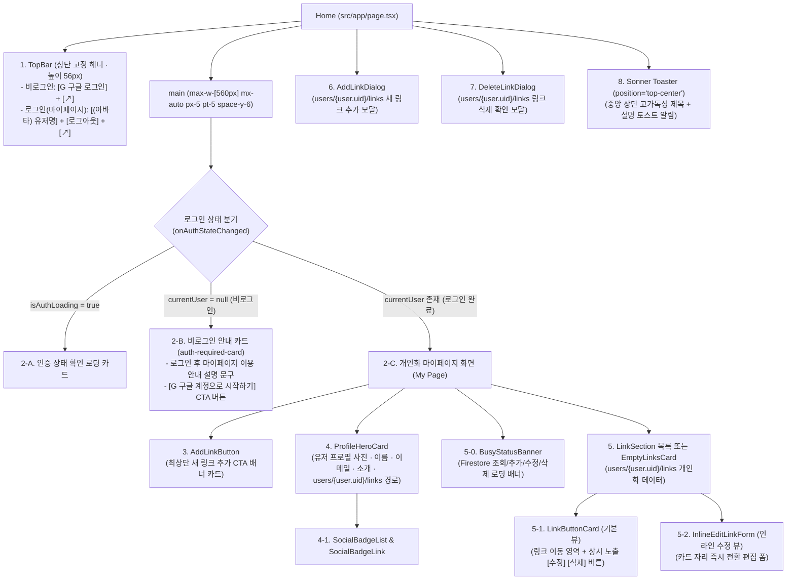

# 마이링크 (MyLink) — 화면 설계 및 와이어프레임 명세서 (Wireframe)

> **문서 버전**: v1.1 (구글 소셜 로그인 헤더 · 로그인/비로그인 분기 화면 · `users/{user.uid}/links` 개인화 **마이페이지** 반영)  
> **최종 수정일**: 2026-11-15  
> **기준 문서**: [`docs/prd.md`](./prd.md) · [`docs/link-edit-delete.md`](./link-edit-delete.md) · [`design.md`](../design.md)  
> **디자인 시스템**: 토스 디자인 시스템(TDS) × `shadcn/ui` × Tailwind CSS v4 (`@theme inline`)  
> **연동 경로**: Firebase Auth (`GoogleAuthProvider`) & Firestore `users/{user.uid}/links`  
> **대상 라우트**: 메인 화면 — 비로그인 안내 화면 & 로그인 후 개인화 **마이페이지** (`/`, [`src/app/page.tsx`](../src/app/page.tsx))

---

## 1. 레이아웃 시스템 및 반응형 규격 (Layout & Responsive Specs)

마이링크(MyLink)는 모바일 바이오 링크 서비스의 특성에 맞춰 **모바일 퍼스트 단일 컬럼 앱 셸(Mobile-First Single-Column App Shell)** 구조를 채택하며, **Firebase Google 소셜 로그인 상태(`currentUser`)**에 따라 비로그인 안내 화면과 개인화 **마이페이지(My Page)** 화면으로 분기됩니다.

| 구분 | 적용 규격 (Tailwind CSS 클래스) | 상세 설명 |
| :--- | :--- | :--- |
| **앱 캔버스 (Root Wrapper)** | `min-h-screen bg-background text-foreground pb-24` | 라이트 모드 `#F2F4F6`(`grey-100`) / 다크 모드 `#111116` 배경, 하단 토스트 여백 확보(`96px`) |
| **상단 고정 헤더 (`TopBar`)** | `sticky top-0 z-20 h-[56px] bg-background/90 backdrop-blur-md border-b border-border` | 좌측 타이틀(`마이링크 (MyLink)` / 로그인 시 `마이페이지`) + 우측 **구글 소셜 로그인 버튼**(비로그인 시) 또는 **유저 아바타·이름 배지 + 로그아웃 버튼**(로그인 시) + 공유 버튼(`[↗]`) |
| **메인 컨테이너 (`main`)** | `max-w-[560px] mx-auto px-5 pt-5 space-y-6` | 최대 폭 `560px` 중앙 정렬, 좌우 패딩 `20px`(`px-5`), 주요 블록 간 수직 간격 `24px`(`space-y-6`) |
| **반응형 브레이크포인트** | 기본(`< 640px`, Mobile) / `sm:`(`>= 640px`, Tablet & Desktop) | - **소셜 배지**: 모바일 `grid-cols-2`(2열 그리드) → 데스크톱 `sm:flex`(가로 중앙 정렬)<br>- **카테고리 섹션 선택**: 모바일 `grid-cols-1` → 데스크톱 `sm:grid-cols-2`<br>- **카드 패딩**: 모바일 `px-4 py-3.5` → 데스크톱 `sm:px-5 sm:py-4` |

---

## 2. 화면 컴포넌트 계층 구조 (Component Hierarchy)



---

## 3. 로그인 여부에 따른 전체 화면 와이어프레임

### 3.1 비로그인 상태 화면 (`currentUser === null`)

로그인하지 않은 방문자에게는 **로그인 이후에 마이페이지를 사용할 수 있음을 안내하는 설명 문구**와 **구글 소셜 로그인 CTA 버튼**을 헤더와 본문 카드에 표시합니다.

```text
+===================================================================================+
| [1. TopBar] sticky top-0 z-20 h-[56px] border-b                                   |
|  마이링크 (MyLink)                                      [ G 구글 로그인 ]  [ ↗ ]  |
+===================================================================================+
|                                                                                   |
|  +-- [2-B. 비로그인 안내 카드 (auth-required-card, rounded-3xl, shadow-tds-2)] -+ |
|  |                                                                              | |
|  |                                 +----------+                                 | |
|  |                                 |    🔒    |  size-16 rounded-3xl bg-accent  | |
|  |                                 +----------+                                 | |
|  |                           [ ✨ Google 소셜 로그인 전용 ]                     | |
|  |                                                                              | |
|  |                   구글 로그인 후 마이페이지를 이용할 수 있어요               | |
|  |         마이링크(MyLink)의 마이페이지는 로그인 이후에 사용할 수 있어요.      | |
|  |           상단 헤더 또는 아래 버튼을 눌러 구글 계정으로 로그인해주세요.      | |
|  |                                                                              | |
|  |  +-- [기능 안내 박스 (bg-secondary/50, rounded-2xl, border-border)] -------+ | |
|  |  |  [👤] 내 구글 유저 정보 마이페이지 표시                                 | | |
|  |  |       로그인한 유저의 이름, 이메일, 프로필 사진이 마이페이지에 표시됨   | | |
|  |  |                                                                         | | |
|  |  |  [🗄️] 개인화된 Firestore 경로 (users/{user.uid}/links)                  | | |
|  |  |       계정별 고유 UID 경로에 나만의 링크 목록을 안전하게 저장합니다.    | | |
|  |  +-------------------------------------------------------------------------+ | |
|  |                                                                              | |
|  |  +-------------------------------------------------------------------------+ | |
|  |  |                   [ G ]  구글 계정으로 시작하기                         | | |
|  |  +-------------------------------------------------------------------------+ | |
|  +------------------------------------------------------------------------------+ |
|                                                                                   |
+===================================================================================+
```

---

### 3.2 로그인 완료 상태 — 마이페이지 화면 (`currentUser !== null`, `users/{user.uid}/links` 개인화)

구글 로그인 완료 시 **마이페이지(My Page)** 화면으로 전환되며, 헤더 좌측에 `마이페이지`, 우측에 **로그인 유저의 아바타·이름 배지(`email.split("@")[0]` 이메일 앞부분 사용)와 `[로그아웃]` 버튼**이 표시됩니다. 본문에는 **해당 유저의 프로필 정보(이메일 앞부분 Display Name, 이메일, 아바타, `users/{user.uid}/links` 경로)**와 **개인화된 링크 목록**이 렌더링됩니다.

```text
+===================================================================================+
| [1. TopBar] sticky top-0 z-20 h-[56px] border-b                                   |
|  마이페이지                                [ (📷) gildong ]  [ ↪ 로그아웃 ] [ ↗ ] |
+===================================================================================+
|                                                                                   |
|  +-- [3. AddLinkButton] (bg-primary #3182F6, rounded-2xl, shadow-tds-2) --------+ |
|  |  [🔗]  새 링크 추가하기                                    [ + 링크 추가 ]   | |
|  |        포트폴리오, 블로그, 소셜 채널 링크를 등록해보세요                     | |
|  +------------------------------------------------------------------------------+ |
|                                                                                   |
|  +-- [4. ProfileHeroCard] (bg-card, rounded-3xl, border-border, px-6 py-8) -----+ |
|  |                                                                              | |
|  |                               +--------------+                               | |
|  |                               |   (Avatar)   |  80x80px (Google photoURL)    | |
|  |                               |  rounded-3xl |  이니셜 폴백 지원             | |
|  |                               +--------------+                               | |
|  |                      [ ✓ 마이페이지 · Google 계정 연동됨 ]                   | |
|  |                                                                              | |
|  |                        gildong (이메일 앞부분 displayName)    (tds-h3)       | |
|  |                          ✉️ gildong@gmail.com (email)         (tds-caption)  | |
|  |                 "gildong@gmail.com · 나만의 마이페이지 프로필 🚀"            | |
|  |                                                                              | |
|  |  +-- [개인화 Firestore 경로 정보 박스 (user-firestore-info)] --------------+ | |
|  |  |  🗄️ 개인화 Firestore 경로   [ users/{user.uid}/links ]                  | | |
|  |  +-------------------------------------------------------------------------+ | |
|  |                                                                              | |
|  |               [ GitHub ]   [ Insta ]   [ LinkedIn ]   [ Email ]              | |
|  +------------------------------------------------------------------------------+ |
|                                                                                   |
|  +-- [5-0. BusyStatusBanner] (isBusy === true 일 때만 조건부 렌더링) -----------+ |
|  |  (⟳) Firestore (users/{user.uid}/links)에서 링크 목록을 불러오는 중이에요... | |
|  +------------------------------------------------------------------------------+ |
|                                                                                   |
|  [5. LinkSection] 🚀 주요 프로젝트 & 포트폴리오                         [+ 추가]  |
|  +-- [5-1. LinkButtonCard] (users/{user.uid}/links 문서 렌더링) ----------------+ |
|  |  🎨 마이링크 (MyLink) 서비스                       →  | [✏️ 수정] [🗑️ 삭제] | |
|  |     토스 디자인 시스템 기반의 바이오 프로필 서비스    | (상시 노출 액션 영역)| |
|  +------------------------------------------------------------------------------+ |
|                                                                                   |
|  [※ 등록된 링크가 0개일 때: EmptyLinksCard (empty-links-card)]                    |
|  +-- [EmptyLinksCard] (rounded-3xl, border-dashed) -----------------------------+ |
|  |                                 [ 📁+ ]                                      | |
|  |                          아직 등록된 링크가 없어요                           | |
|  |     개인화 경로(users/{user.uid}/links)에 저장된 링크가 없습니다.            | |
|  |     첫 번째 링크를 추가해 나만의 프로필을 완성해보세요!                      | |
|  |                            [ + 첫 링크 추가하기 ]                            | |
|  +------------------------------------------------------------------------------+ |
|                                                                                   |
|                      +------------------------------------+                       |
|                      | [8. ShareToast] (fixed bottom-6)   |                       |
|                      |       "홍길동님, 환영해요!"        |                       |
|                      +------------------------------------+                       |
+===================================================================================+
```

---

## 4. 컴포넌트 및 상태별 상세 와이어프레임 (Component & State Wireframes)

### 4.1 상단 앱 바 (`TopBar` — [`src/components/mylink/top-bar.tsx`](../src/components/mylink/top-bar.tsx))

- **인증 상태 확인 중 (`isAuthLoading = true`)**:
```text
+-------------------------------------------------------------------------+
| 마이링크 (MyLink)                                     [ ⟳ 확인 중 ] [↗] |
+-------------------------------------------------------------------------+
```

- **비로그인 상태 (`user = null`)**:
```text
+-------------------------------------------------------------------------+
| 마이링크 (MyLink)                                 [ G 구글 로그인 ] [↗] |
+-------------------------------------------------------------------------+
```

- **로그인 완료 상태 (`user !== null` — 마이페이지)**:
```text
+-------------------------------------------------------------------------+
| 마이페이지                              [ (📷) 홍길동 ] [ 로그아웃 ] [↗] |
+-------------------------------------------------------------------------+
```

---

### 4.2 링크 버튼 카드 (`LinkButtonCard` — [`src/components/mylink/link-button-card.tsx`](../src/components/mylink/link-button-card.tsx))

`LinkButtonCard`는 **1) 기본 카드 뷰**와 **2) 인라인 수정 뷰(`InlineEditLinkForm`)** 두 가지 상태를 가지며, 모든 수정·삭제는 현재 로그인한 유저의 `users/{user.uid}/links/{link.id}` 경로에 반영됩니다.

#### A. 기본 카드 뷰 (`isEditing = false`)
```text
+-------------------------------------------------------------------------+
| [외부 링크 이동 영역 (<a>)]                       | [상시 노출 액션]    |
|                                                   |                     |
|  🎨  마이링크 (MyLink) 서비스 (CardTitle)      →  |  [✏️ 수정] [🗑️ 삭제] |
|      토스 디자인 시스템 기반 바이오 프로필...     |  (secondary)(danger)|
+-------------------------------------------------------------------------+
```

#### B. 인라인 수정 뷰 (`isEditing = true`, `InlineEditLinkForm`)
```text
+-------------------------------------------------------------------------+
| 링크 인라인 수정 (마이링크 (MyLink) 서비스)                       [ ✕ ] |
| ----------------------------------------------------------------------- |
| 카테고리 섹션 (2열 그리드 선택)                                         |
| 아이콘 이모지 * (12종 프리셋 버튼 또는 직접 입력 최대 4자)              |
| 링크 제목 * (2~40자 및 동일 섹션 중복 검증)                       18/40 |
| 한 줄 설명 (선택, 80자 이내)                                      38/80 |
| 이동할 URL * (도메인 검증 및 정규화 주소 실시간 미리보기)               |
|                                                 +--------+ +----------+ |
|                                                 |  취소  | | ✓ 저장   | |
|                                                 +--------+ +----------+ |
+-------------------------------------------------------------------------+
```

---

### 4.3 새 링크 추가 모달 다이얼로그 (`AddLinkDialog` — [`src/components/mylink/add-link-dialog.tsx`](../src/components/mylink/add-link-dialog.tsx))

- **저장 경로**: `users/{user.uid}/links` 컬렉션에 새 문서를 추가하고 `getDocs`로 목록을 재조회(갱신형)합니다.

```text
+=========================================================================+
|  +-- [DialogContent] (max-w-[500px], rounded-2xl, shadow-tds-3) ------+ |
|  | 새 링크 추가                                                 [ ✕ ] | |
|  | 프로필 페이지에 노출할 새로운 링크 카드를 추가합니다.              | |
|  | (Firestore users/{user.uid}/links에 저장됩니다)                    | |
|  |                                                                    | |
|  | 1. 카테고리 섹션 선택 (4개 섹션 그리드)                            | |
|  | 2. 아이콘 이모지 선택 및 직접 입력                                 | |
|  | 3. 링크 제목 입력 (2~40자)                                         | |
|  | 4. 한 줄 설명 입력 (0~80자)                                        | |
|  | 5. 이동할 URL 입력 (실시간 정규화 주소 확인)                       | |
|  | 6. 프로필에 바로 노출하기 (Switch)                                 | |
|  | 7. 실시간 카드 미리보기 (LinkButtonCard 재사용)                    | |
|  |                                    +--------+ +------------------+ | |
|  |                                    |  취소  | | + 링크 추가하기  | | |
|  +--------------------------------------------------------------------+ |
+=========================================================================+
```

---

### 4.4 링크 삭제 확인 모달 다이얼로그 (`DeleteLinkDialog` — [`src/components/mylink/delete-link-dialog.tsx`](../src/components/mylink/delete-link-dialog.tsx))

```text
+=========================================================================+
|  +-- [DialogContent] (max-w-[420px], rounded-2xl, shadow-tds-3) ------+ |
|  | 정말 삭제하시겠습니까?                                       [ ✕ ] | |
|  | 선택한 링크 카드를 프로필 목록과 Firestore에서 영구적으로          | |
|  | 삭제합니다.                                                        | |
|  |                                                                    | |
|  | +-- [삭제 대상 링크 정보 박스 (bg-secondary/50, rounded-xl)] ----+ | |
|  | | 🎨 마이링크 (MyLink) 서비스                                    | | |
|  | |    https://mylink.example.com                                  | | |
|  | +----------------------------------------------------------------+ | |
|  |                                                                    | |
|  | ⚠️ 이 작업은 되돌릴 수 없습니다  (text-destructive #F04452, bold)  | |
|  |                                                                    | |
|  |                                        +--------+ +--------------+ | |
|  |                                        |  취소  | | 🗑️ 삭제하기  | | |
|  |                                        +--------+ +--------------+ | |
|  +--------------------------------------------------------------------+ |
+=========================================================================+
```

---

## 5. 사용자 인터랙션 및 화면 전환 흐름 (User Flow Matrix)

| 사용자 액션 | 시작 위치 | 화면 전환 / UI 반응 | 데이터 및 상태 처리 (`useMyLinkStore`) | 완료 피드백 |
| :--- | :--- | :--- | :--- | :--- |
| **구글 소셜 로그인** | `TopBar` 우측 `[G 구글 로그인]` 또는 본문 안내 카드의 `[구글 계정으로 시작하기]` | Google 팝업 로그인 후 개인화 **마이페이지** 화면으로 전환 | `signInWithPopup` → `syncUserProfileAndLinks(authUser)` → `users/{user.uid}` 프로필 병합 및 `users/{user.uid}/links` 조회 | 하단 `ShareToast`: `"{이름}님, 환영해요!"` |
| **로그아웃** | `TopBar` 우측 `[로그아웃]` 버튼 | 즉시 비로그인 안내 화면(`auth-required-card`)으로 전환 | `signOut(auth)` → `currentUser: null` 및 로컬 링크 목록 초기화 | 하단 `ShareToast`: `"로그아웃되었어요"` |
| **새 링크 추가** | `AddLinkButton` 또는 빈 상태 카드의 `[+ 첫 링크 추가하기]` | `AddLinkDialog` 모달 오픈 → 폼 입력 및 미리보기 확인 → `[+ 링크 추가하기]` 클릭 | `addLink(input)` → Firestore `users/{user.uid}/links`에 `addDoc` → `syncLinksFromFirestore(uid)`(`getDocs` 재조회) | 모달 닫힘 + 하단 `ShareToast`: `"새로운 링크를 추가했어요"` |
| **링크 인라인 수정** | `LinkButtonCard` 우측 `[✏️ 수정]` 버튼 | 해당 카드가 즉시 `InlineEditLinkForm`으로 전환 → 수정 후 `[✓ 저장]` 클릭 | `updateLink(id, input)` → Firestore `users/{user.uid}/links/{id}` `updateDoc` → `syncLinksFromFirestore(uid)`(`getDocs` 재조회) | 기본 카드 뷰 복귀 + 하단 `ShareToast`: `"링크 정보를 수정했어요"` |
| **링크 삭제** | `LinkButtonCard` 우측 `[🗑️ 삭제]` 버튼 | `DeleteLinkDialog` 모달 오픈 → 경고 확인 후 `[🗑️ 삭제하기]` 클릭 | `deleteLink(id)` → Firestore `users/{user.uid}/links/{id}` `deleteDoc` → `syncLinksFromFirestore(uid)`(`getDocs` 재조회) | 모달 닫힘 + 하단 `ShareToast`: `'"{제목}" 링크를 삭제했어요'` |
